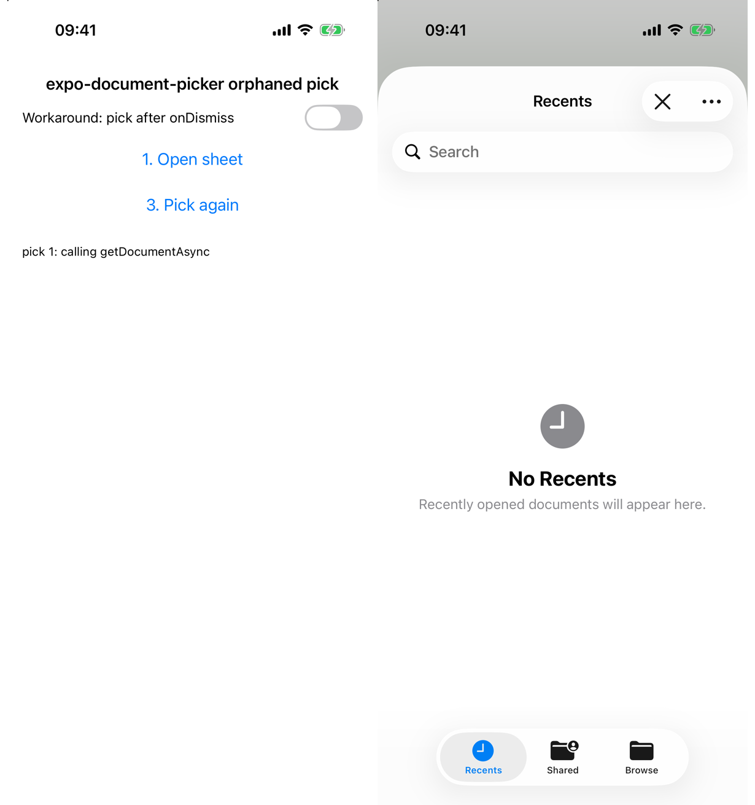
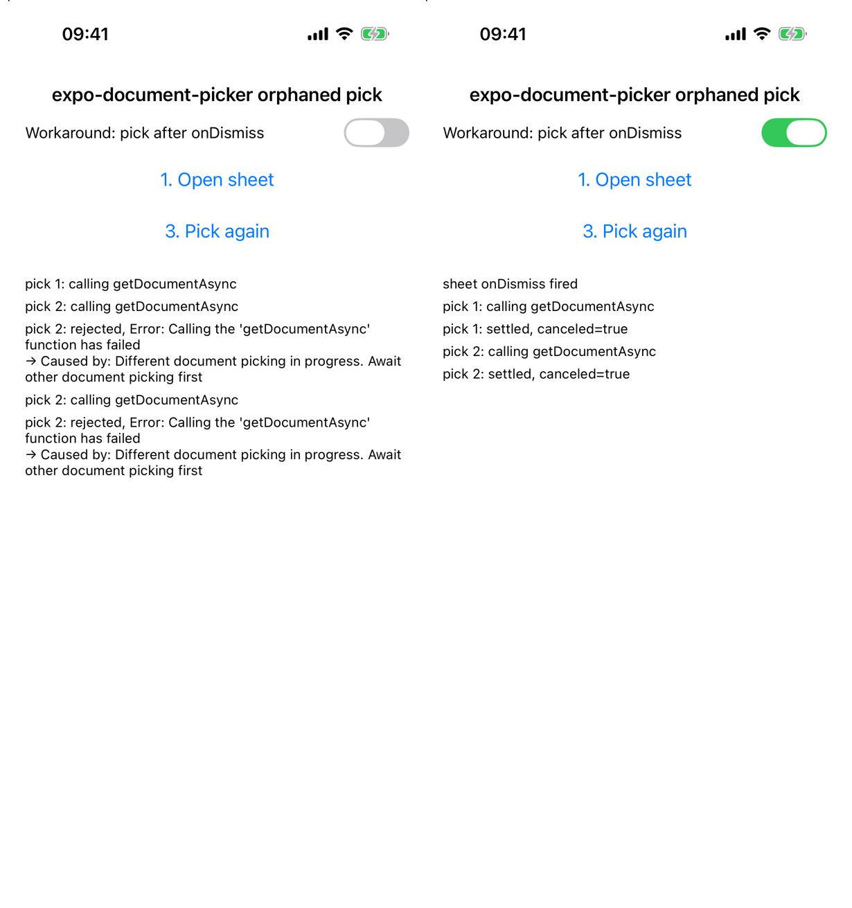
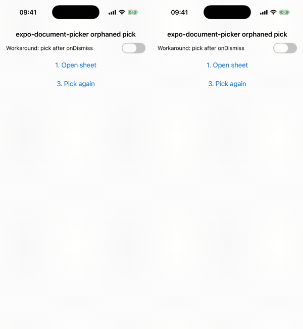

# getDocumentAsync never settles after a dismissing sheet, then rejects every later call (iOS)

Reproduction for https://github.com/expo/expo/issues/53827 on iOS.

Versions: Expo SDK 58 (`expo` 58.0.26), `expo-document-picker` 58.0.5, `expo-modules-core` 58.1.0,
`react-native` 0.88.1, New Architecture.
Recorded on the iPhone 17 Pro simulator, iOS 26.5, Xcode 27.2, 11/22/26.

## Run

```sh
npm install
npx expo run:ios   # development build, iOS simulator or device
```

## What the screen shows

Three buttons and a log. **1. Open sheet** presents a React Native `Modal` with
`presentationStyle="pageSheet"`. Inside the sheet, **2. Attach a file** closes the sheet and calls
`DocumentPicker.getDocumentAsync()` in the same tick, which is the pattern from the issue.
**3. Pick again** calls `getDocumentAsync()` from the root screen. Every call and its outcome is
appended to the log.

The switch at the top swaps how the attach button behaves:

| Switch | `2. Attach a file` |
| --- | --- |
| off (bug) | `setSheetVisible(false)` then `getDocumentAsync()` immediately, as in the issue |
| on (workaround) | `setSheetVisible(false)`, then `getDocumentAsync()` from the Modal's `onDismiss` |

## Result

Each tap was sent as a mouse click on the simulator and the log read back from screenshots.
The app was relaunched between the two runs because the stuck state survives for the life of
the process.

| Step | Expected | Bug (switch off) | Workaround (switch on) |
| --- | --- | --- | --- |
| 1. Open sheet | Sheet slides up | Sheet slides up | Sheet slides up |
| 2. Attach a file | Sheet closes, picker appears | Sheet closes, **no picker**, `pick 1` logged as calling and **never settles** | Sheet closes, `onDismiss` fires, picker appears; closing it settles `pick 1` with `canceled=true` |
| 3. Pick again | Picker appears | **Rejected**: `Different document picking in progress. Await other document picking first` | Picker appears; closing it settles `pick 2` with `canceled=true` |
| 3. Pick again, second time | Picker appears | **Rejected** with the same error | not needed |
| Relaunch the app | | Clears the stuck state | |

Once the first call is orphaned, no later `getDocumentAsync()` call in that process can open a
picker. The native module still believes a pick is in progress.
Raw tap logs: `media/bug-same-tick.txt`, `media/workaround-on-dismiss.txt`.

## Media







Screen recordings: `media/bug-same-tick.mp4` and `media/workaround-on-dismiss.mp4`.
Per-step screenshots: `media/bug-same-tick-*.png` and `media/workaround-on-dismiss-*.png`.
Simulator and toolchain details: `media/simulator-ios-version.txt`.
